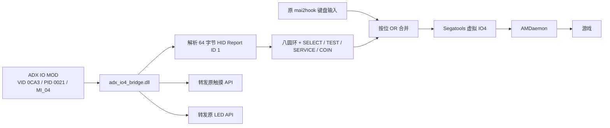

# ADX IO4 Repairer

面向 ADX 三代 IO MOD 的 Windows x64 `mai2io` 输入桥接。它读取 `VID_0CA3 / PID_0021 / MI_04` 的实体 IO4 HID 报告，把八个圆环按键和 SELECT、TEST、SERVICE、COIN 接入现有 Segatools 虚拟 IO4 输入链路，同时沿用当前 `mai2hook.dll` 的键盘、触摸和灯光实现。

> 当前公开源码对应 **Bridge 1.0**。预编译 DLL 位于 GitHub Releases，并附 SHA-256。

## 已解决的现场问题

| 场景 | 现场表现 | 修复方式 | 实机结果 |
|---|---|---|---|
| SLS，2026-10-18 | Windows 与 ConfigApp 可读取实体按键；游戏接收到虚拟 IO4/键盘输入 | `adx_io4_bridge.dll` 读取 MI_04，并把实体输入合并进虚拟 IO4 链路 | 八圆环、SELECT、TEST、SERVICE、COIN、触摸、灯光与进游戏流程通过 |
| PC-HOME，2026-10-19 | 迁移后所有内屏区域的长按快速闪断 | `mai2.ini` 设置 `[AM] DummyTouchPanel=0`，桥接和 Segatools 保持原配置 | TEST 所有区域稳定，实际谱面长按与实体圆环按键通过 |

这两次修复对应两条输入链路：Bridge 处理实体圆环和侧键；`DummyTouchPanel=0` 让游戏持续采用实体串口触摸状态。

## 工作原理



核心行为：

- 精确选择 `VID_0CA3 / PID_0021 / MI_04`。
- 校验 `UsagePage=1`、`Usage=4` 和 64 字节输入报告。
- 使用 Overlapped I/O 后台读取 HID。
- 解析八圆环、SELECT、TEST、SERVICE 和 COIN。
- 将实体输入与原键盘输入按位合并。
- 将触摸与 LED API 转发给当前 `mai2hook.dll`。
- 报告超过 250 ms 未刷新时释放实体状态；设备恢复后自动重新枚举。
- 生成 `adx_io4_bridge.log` 状态日志。
- 控制器链路采用只读 HID 访问。

## 适用环境

| 项目 | 已验证值 |
|---|---|
| 系统 | Windows x64 |
| 控制器 | ADX 三代 1P IO MOD |
| HID | `VID_0CA3 / PID_0021 / MI_04` |
| Usage | Generic Desktop / Joystick，`UsagePage 1 / Usage 4` |
| 报告 | 64 字节，Report ID `1` |
| mai2io API | `0x0102` |
| 输入链路 | Segatools 虚拟 IO4 保持开启 |

更多固件、2P 设备、高密度谱面长期运行和端到端延迟量测适合作为后续兼容性扩展。

## 安装

1. 从 [Releases](https://github.com/DeGuKe/ADX-IO4-Repairer/releases) 下载 `adx_io4_bridge.dll`，核对发布页 SHA-256。
2. 备份当前 `segatools.ini`，把 DLL 放到实际游戏 `Package` 目录，与 `mai2hook.dll` 同级。
3. 在 `segatools.ini` 设置：

```ini
[mai2io]
path=adx_io4_bridge.dll
```

4. 保持 Segatools 虚拟 IO4 开启。现场对照中关闭虚拟 IO4会出现：

```text
NodeList::setup
Message: ID 0 not found.
```

5. 使用实体串口触摸时，在 `mai2.ini` 设置：

```ini
[AM]
DummyTouchPanel=0
```

6. 退出 ADX ConfigApp 后启动游戏，让桥接稳定读取 MI_04。
7. 打开 `adx_io4_bridge.log`，确认出现 `ADX bridge 1.0 starting` 与 `MI_04 connected`。
8. 在游戏 INPUT TEST 中逐一验证八圆环、SELECT、TEST、SERVICE 与 COIN，再验证触摸长按和灯光。

## 构建

需要 Visual Studio 2022 C++ Build Tools 和 Windows SDK。脚本会通过 `vswhere` 查找 Community、Professional、Enterprise 或 Build Tools：

```powershell
scripts\build.cmd
```

输出为 `dist\adx_io4_bridge.dll`。等价编译参数：

```bat
cl /nologo /W4 /O2 /MT /LD src\adx_bridge.c ^
  /link /OUT:dist\adx_io4_bridge.dll setupapi.lib hid.lib user32.lib
```

每次提交也会由 GitHub Actions 在 Windows x64 环境执行构建、HID 报告解码测试并上传工作流产物。

## 验证

### 自动解码测试

```powershell
python tools\verify.py --bridge dist\adx_io4_bridge.dll tests\fixtures\capture.jsonl
```

测试覆盖八圆环、SELECT、TEST、SERVICE、空闲态、异常长度和异常 Report ID。

### 隔离 API 转发测试

`tests/test_original.c` 是专用测试夹具。它在隔离目录中编译为模拟 `mai2hook.dll`，用于检查键盘状态保留、触摸和 LED 参数/返回值转发：

```powershell
scripts\build-test-fixture.cmd
python tools\verify.py --live --bridge dist\adx_io4_bridge.dll --stub dist\mai2hook.dll tests\fixtures\capture.jsonl
```

夹具 DLL 的用途限定在 `dist` 测试目录。

## 故障排查

| 表现 | 优先检查 |
|---|---|
| 日志缺少 `ADX bridge 1.0 starting` | `[mai2io] path`、DLL 位置、x64 架构、当前 Hook 的 mai2io API |
| 有启动日志，等待 `MI_04 connected` | ConfigApp 占用、MI_04 接口、64 字节报告、设备管理器状态 |
| 报告计数增长，游戏仍无实体按键 | Segatools 虚拟 IO4 状态、按钮映射、当前 `mai2hook.dll` 兼容性 |
| 所有触摸区域长按快速闪断 | `[AM] DummyTouchPanel=0` |
| 出现 `ID 0 not found` | 恢复 Segatools 虚拟 IO4 |
| TEST 短按无响应 | 持续按住约 60 个游戏更新帧 |

完整案例见 [SLS 成功修复](docs/SLS_SUCCESS_CASE.md)、[PC-HOME 迁移与触摸修复](docs/PC_HOME_TOUCH_FIX.md) 和 [架构说明](docs/ARCHITECTURE.md)。

## 版本关系

| 版本 | 对应材料 | SHA-256 | 说明 |
|---|---|---|---|
| Bridge 1.0 | 本仓库 `src/adx_bridge.c` 与 Release DLL | `00263fe9eb5bcdd849f37474d11caaf8b18859c5939b1d1b629af3692a3bd59a` | SLS 原始成功实现 |
| Bridge 1.1 | PC-HOME 现场加载 DLL | `b6eba97ad989fed70d5977c94be4658ba697738d286b5e80a8a3bebf591ce07f` | PC-HOME 回归通过；对应源码将在取得后归档 |
| PC-HOME 触摸配置 | 修复后 `mai2.ini` | `1ca7311bde5b5ee3b0022ce7f38759bdb1ffd4099c2a8501aa0692746526cacc` | `DummyTouchPanel=0` |

公开 Release 以 1.0 源码和 1.0 DLL 的精确对应关系为准。

## 仓库结构

```text
src/                 桥接源码
scripts/             可移植构建脚本
tools/               验证工具
tests/               测试夹具与脱敏 HID 测试向量
docs/                架构、现场案例与排查记录
checksums/            历史发布哈希
.github/workflows/    Windows 自动构建与解码测试
```

## 致谢

- [CrackerCat/segatools](https://github.com/CrackerCat/segatools)：IO4、mai2io 与虚拟设备实现。
- [MuNET-OSS/AquaMai](https://github.com/MuNET-OSS/AquaMai)：输入、TEST 长按与调试行为。
- [alfredodeux/adx-mai2io-dll](https://github.com/alfredodeux/adx-mai2io-dll)：社区 ADX HID 实验。
- [ADX-Controller-Guide](https://github.com/maimai-dx/ADX-Controller-Guide)：设备连接资料。
- [TeamMajdata/MajdataPlay](https://github.com/TeamMajdata/MajdataPlay)：独立硬件兼容性实现。

项目与相关游戏、硬件厂商及上述第三方项目分别独立维护。仓库收录桥接源码、测试和脱敏案例资料。

## License

[MIT](LICENSE)
