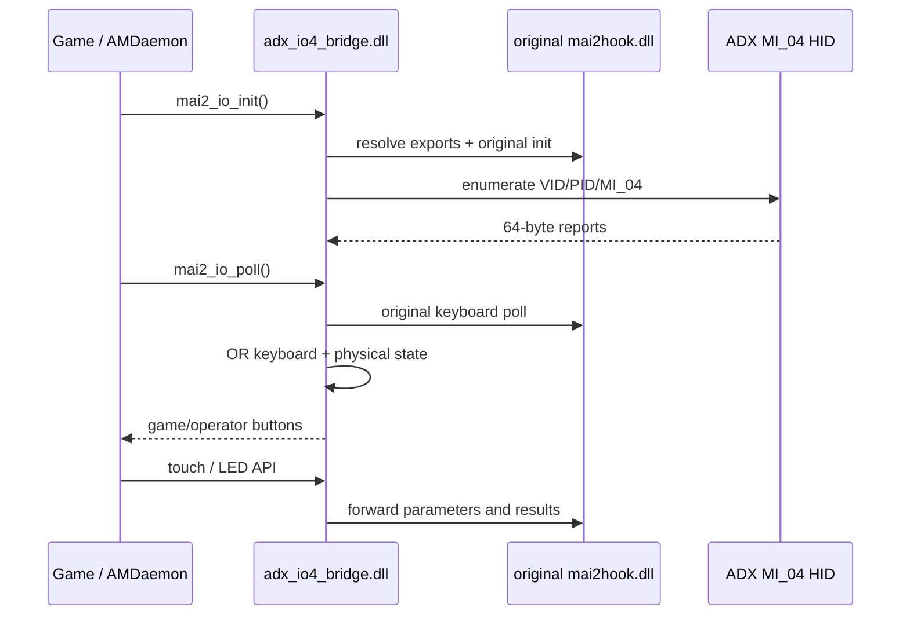

# Architecture

## 数据路径

Bridge 作为自定义 `mai2io` DLL 被现有 Hook 加载。初始化时，它从已加载的 `mai2hook.dll` 取得原始输入、触摸和灯光导出，然后启动一个 HID 读取线程。

## HID 选择

枚举使用 Windows HID GUID 与 SetupAPI。设备路径需匹配 `vid_0ca3&pid_0021&mi_04`，随后再次校验：

- Vendor ID `0x0CA3`
- Product ID `0x0021`
- Input report length `64`
- Usage Page `1`
- Usage `4`

这套选择规则把游戏控制器接口与 MI_02 键盘、MI_00 串口清楚分开。

## 报告解码

输入报告要求 Report ID `1`。圆环状态位于第 29–30 字节并采用低电平有效：

| 逻辑输入 | 掩码 |
|---|---:|
| Button 1–8 | `0004 0008 0001 8000 4000 2000 1000 0800` |
| SELECT | `0002` |
| TEST | `0200` |
| SERVICE | `0040` |

COIN 使用第 26 字节的非零变化脉冲。实体按钮与原 1P 键盘状态按位 OR 合并，2P 和原操作键状态继续保留。

## 生命周期

- Overlapped `ReadFile` 在后台线程持续接收报告。
- 250 ms 报告过期阈值负责释放残留实体状态。
- 连接断开后释放句柄，等待 500 ms 后重新枚举。
- `adx_io4_bridge.log` 只记录连接和状态变化，便于现场定位。
- HID 访问使用 `GENERIC_READ`，设备固件和输出端点保持原状态。

## 触摸与灯光

Bridge 将 `mai2_io_touch_*` 与 `mai2_io_led_*` 导出转发给当前 `mai2hook.dll`。因此实体按键修复可以和既有 COM3 触摸、COM21 灯光路径协同运行。
